<picture>
  <source media="(prefers-color-scheme: dark)" srcset="https://raw.githubusercontent.com/indranil098/indranil098/main/assets/ascii-night-dark.svg" />
  
</picture>

### Indranil Chatterjee

**B.Tech CSE student · builder · shipping in public**

`AI` · `developer tools` · `web` · `education`

[Portfolio](https://portfolio.indradev.workers.dev) · [Resume](https://github.com/indranil098/indranil098/blob/main/Indranil_Chatterjee_Resume%20%281%29.pdf)

---

### about

I build practical software and learn by shipping it — from data model to last pixel.

Most of my time goes into AI-powered applications, developer tooling and full-stack web products. I care more about a thing working well in someone's hands than about the stack it's written in.

- building my startup **SuperMynd AI** along with **Movsee** and **HyperGym**
- exploring **LLM tooling**, **OSINT research tooling** and real-time visual experiments
- comfortable across TypeScript, Python, React Native and Cloudflare

---

### now building

| project | what it is | link |
| --- | --- | --- |
| **[SuperMynd AI](https://supermynd.in)** — my startup | white-label AI assessment infrastructure for coaching institutes — Bengali-first, syllabus-aligned, with batch analytics | [supermynd.in](https://supermynd.in) |
| **[Movsee](https://movsee.indradev.workers.dev)** | a home for movies and TV — discovery, search, cast, multi-server playback that remembers where you left off | [movsee](https://movsee.indradev.workers.dev) |
| **[HyperGym](https://github.com/indranil098/HyperGym)** | say what you trained, an LLM coach drafts the log — React Native, no backend, on-device | [apk](https://github.com/indranil098/HyperGym/releases/latest) |

---

### selected work

| | |
| --- | --- |
| **[ASCII Vision Pro](https://github.com/indranil098/ASCII-Vision-Pro-)** | real-time ASCII camera for the web — high-fidelity character mapping, gain/contrast/density controls, CRT colour filters, 4K export |
| **[Universal LLM Tokenizer](https://github.com/indranil098/universal-llm-tokenizer)** | tokenization playground and developer tooling for working with LLM inputs |
| **[AI Book Maker](https://github.com/indranil098/Ai-book-maker)** | generating structured books and related content with AI pipelines |

plus a few private builds — an OSINT research workbench and other experiments — and more ideas in the [repository list](https://github.com/indranil098?tab=repositories).

---

### toolkit

  
  
  
  
  
  
  
  
  
  
  
  
  

---

<picture>
  <source media="(prefers-color-scheme: dark)" srcset="https://raw.githubusercontent.com/indranil098/indranil098/output/github-contribution-grid-snake-dark.svg" />
  
</picture>

<code>commit → build → experiment → ship → repeat</code>

---

**build things. learn from them. make them better.**

